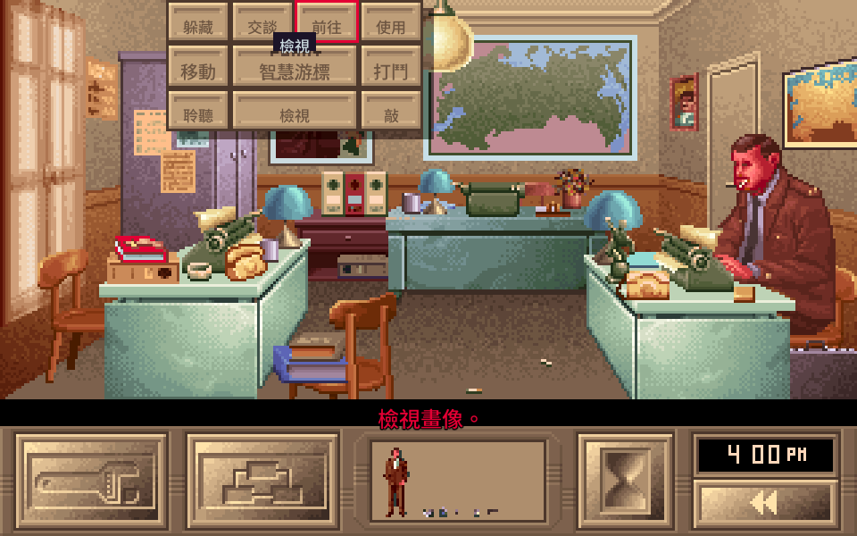
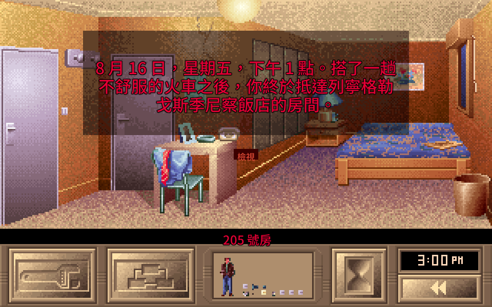
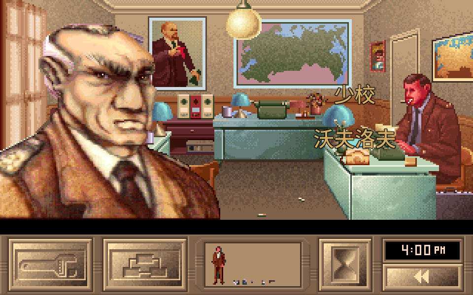

# kgb-dosgolem：KGB 中文化

Cryo《KGB》CD 版（片名 *Conspiracy*，光碟卷名 `CONSPIRACY`）的繁體中文與簡體中文化。遊戲跑在自有的 Rust DOS 模擬器 [FerroGolem](https://github.com/wicanr2/ferrogolem) 上；本庫攔下遊戲畫字的程式，跳過英文，把中文畫在放大 3 倍的高解析覆繪層。原版檔案一個位元組都不改。

開場字幕、四章對白與旁白、說明影片字幕、選單、游標、片頭與片尾名單都已有中文，四章都在遊戲裡抽樣確認過。工具列可以隨時切換繁中、简中與英文原版。聲音還沒有輸出。


*第一章開場，KGB P 處的辦公室。旁白、地點列「你的辦公室」與游標動詞「檢視」都是覆繪層上的中文。截圖為 `kgb-run` 實跑，cycles 1000，繁中。*

## 緣起

bilibili 上的夥伴索菲婭（ソフィア）希望我中文化一款冷門的經典遊戲，這個專案從那裡開始。

## 故事

以下摘自遊戲的開場旁白與章節標題。

主角馬克西姆·米哈伊洛維奇·魯科夫原本是特種部隊（Spetsnaz）軍官，隸屬軍事情報局格魯烏。1991 年 8 月，他被「邀請」調進莫斯科 KGB 第二總局一個他從沒聽過的部門：P 處。他的父母在他小時候死於塔吉克的一場汽車炸彈；同樣當過格魯烏軍官的萬尼亞叔叔提醒他，盡忠職守，但要提防背後。

| 章 | 時間與地點 |
|---|---|
| 一 | 莫斯科，1991 年 8 月 14 日，KGB P 處 |
| 二 | 列寧格勒，8 月 16 日星期五，戈斯季尼察飯店 |
| 三 | 列寧格勒，8 月 17 日星期六，碼頭 |
| 四 | 列寧格勒，8 月 18 日星期日，碼頭 |

開場旁白說，這段冒險取材自 1991 年 8 月的一連串事件，而那場政變最後失敗了。最後一章的 8 月 18 日，是政變爆發的前一天。

## 畫面

| | |
|---|---|
|  |  |
| 和別洛夫交談的「詢問」子選單，選項依原版英文行的中點置中。 | 右鍵動作選單。按鈕上的英文是圖塊，覆繪時先用原版底色蓋掉再寫中文。 |
|  |  |
| 第二章，列寧格勒飯店 205 號房。 | 第四章，19 號碼頭，地點列「前往棧橋。」 |
|  |  |
| 按倒帶鈕後的重播模式，框內訊息與回答都是中文。 | 片頭名單，職稱譯成中文，人名保留原文，跟著原版每頁的淡入淡出。 |
|  | |
| 片尾演員表，角色名畫在頭像另一側。這張用取證選項從第一章觸發，背景與正常破關不同。 | |

截圖都是 `kgb-run` 無頭實跑的 3 倍覆繪畫面（繁中）。第二、四章與片尾用取證選項 `--chapter`、`--end-credits` 直接進入，只改暫存器，見 [docs/re/006](docs/re/006-chapter-start.md) 與 [docs/spec/006](docs/spec/006-credits.md)。

## 中文化的做法

KGB 把英文畫在 320×200 的畫面上。直接改原版字串會碰到字寬、換行與存檔相容的問題，所以本專案在模擬器裡攔下遊戲自己的畫字程式：

- 遊戲要畫一段英文時，以原文查譯文表，跳過原版的繪字，並回傳原版會回傳的值，遊戲照常往下走。
- 中文用 Noto Sans CJK 畫在 960×600 的覆繪層，圓角描邊；原版畫面放大後墊在底下。
- 對話由片語拼成，插槽在執行期填入物件名稱；覆繪依遊戲解碼片語的順序，逐段組合譯文。
- 選單按鈕、游標動詞、開場字卡是圖片，改以圖塊編號與位置辨識，在原圖上蓋中文。
- 英文原文只當查表鍵。章節片語的鍵存成雜湊，原文不進版控。

| 譯文表 | 內容 | 不重複句數 |
|---|---|---|
| `intro` | 開場字幕 | 47 |
| `chapter1`–`chapter4` | 四章對白、旁白、選單 | 3,506／2,501／298／768 |
| `help-ch1`、`help-ch234` | 說明影片字幕 | 132／172 |
| `credits` | 片頭、片尾名單的職稱與角色名 | 80 |

翻譯以英文為主、法文對照，專名依[譯名表](text/glossary.tsv)，規則見 [text/TRANSLATING.md](text/TRANSLATING.md)。簡中由繁中以 OpenCC `tw2sp` 轉換，再以譯名表的簡中欄覆寫專名。

## 現況與待辦

| 項目 | 狀態 |
|---|---|
| 開場、四章、說明影片、選單、名單 | 有中文，四章與名單在遊戲裡抽樣確認 |
| 繁中、简中、英文原版切換 | 可用 |
| 聲音 | 未輸出（[#3](https://github.com/wicanr2/kgb-dosgolem/issues/3)） |
| 物品插槽句（例：把 X 扔進水裡） | 未實測（[#5](https://github.com/wicanr2/kgb-dosgolem/issues/5)） |
| 公開發行包 | 本機完整版可建，公開版未做（[#1](https://github.com/wicanr2/kgb-dosgolem/issues/1)、[#2](https://github.com/wicanr2/kgb-dosgolem/issues/2)） |

詳細現況在 [CONTEXT.md](CONTEXT.md)，待辦以 [docs/worklist.json](docs/worklist.json) 為準，並對應 [GitHub issues](https://github.com/wicanr2/kgb-dosgolem/issues)。

## 執行

需要合法的 KGB CD 版。本庫不含遊戲檔、影片、音訊與字型；`docs/images/` 只有上面幾張中文化截圖。

建置與執行都在 Docker 內，並需要旁邊的 `../ferrogolem` 與主機的 Noto Sans CJK 字型（`NotoSansCJK-Medium.ttc`）。先依 [docs/re/001](docs/re/001-disc-inventory.md) 從光碟映像解出檔案，再：

```sh
tools/rust.sh fetch                 # 抓依賴，只有這一步開網路
tools/rust.sh build
tools/rust.sh test
tools/rust.sh play                  # 在 X11 桌面開視窗玩；預設語言依系統語系
tools/package.sh with-data all      # 本機完整版（Linux、Windows、macOS），放 workplace/dist/
```

本機完整版內含原版資料，只供自己使用，請勿散布。

## 文件

- [工作契約](AGENTS.md)、[目前狀態](CONTEXT.md)、[歷程](WORKLOG.md)
- [證據索引](docs/re/README.md)
- 規格：[文字接手](docs/spec/004-kgb-text-takeover.md)、[圖片文字](docs/spec/005-sprite-labels.md)、[名單](docs/spec/006-credits.md)

## 授權

自有程式與文件採 RRSAL-1.0（復古重製 source-available 授權：非商業免費使用、允許實況影片），全文見 [LICENSE](LICENSE)。授權不涵蓋原版遊戲的程式、影像、聲音與文字。字型 Noto Sans CJK 採 SIL Open Font License 1.1。

《KGB》著作權屬 Cryo Interactive、Virgin Games 及其權利繼承者。本專案與上述公司沒有隸屬或授權關係。
